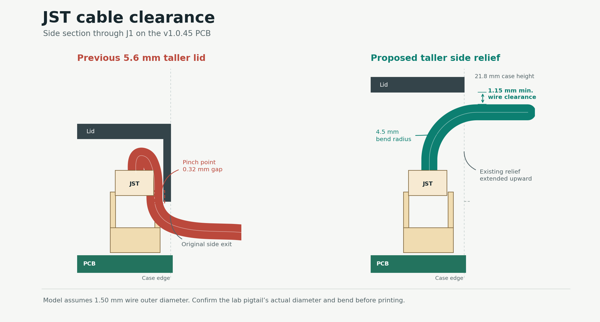

# NEMA17 taller lid for PCB v1.0.45

This draft adapts the original plain v4 lid for the [RP2040 motor controller
v1.0.45](https://tscircuit.com/imrishabh18/rp2040-motor-controller?version=1.0.45#3d).
The v1.0.45 board has a top-entry JST PH B4B-PH-K-S at J1. The mating plug
seats into that header above the PCB, and the four wires curve over the board
edge through the raised side relief.



## Draft files

- [Editable STEP](top-v1.0.45-jst-draft.step)
- [STL for a fit print](top-v1.0.45-jst-draft.stl)
- [CAD fit report](fit-report.json)

The assembled case is 21.8 mm high from the existing base datum and uses the
42 × 42 mm footprint, released base, both USB-C openings, and the original
31 × 31 mm screw pattern. The 1.4 mm roof is solid. The existing 11.3 mm-wide
side relief extends to 15.4 mm above the PCB. The M3 head seats stay at Z=8.6 mm,
so the screw wells are deeper and require a tool that can reach the heads.

## Fit evidence

The builder compares the lower lid section to the released v4 geometry,
checks the through-bores and head seats, and intersects the lid and base with
111 component bounds from the pinned board export. It also checks a mated
plug envelope and four swept wire solids. The wire model assumes 1.5 mm
insulation diameter, an 8.03 mm mated height above the board, and a 4.5 mm
bend radius. Conservative roof headroom is 1.15 mm. The CAD separation
between the modeled wires and the lid is 1.27 mm.

Measure the seated lab pigtail, its insulation and bend, and both USB-C
overmolds before a fit print. Motor mounting and fastener engagement still
need verification on the actual StepperOnline 17E1K-05. For a first print,
check that a driver reaches the recessed heads and inspect the sliced roof
and opening edges for supports.

## Rebuild

From the repository root, install
`mechanical/nema17-enclosure/requirements.txt` in a Python virtual environment
and run the builder.

```sh
python mechanical/nema17-enclosure/prototypes/v1.0.45-jst/build.py --output /tmp/nema17-jst-lid
```

`component-envelopes.json` records the Circuit JSON and GLB hashes. The GLB
comes from the pinned Circuit JSON using `circuit-json-to-gltf@0.0.166`.
The bounds are in the v4 assembly datum, with the PCB top at Z=5.0 mm.
The connector entries keep their per-primitive bounds to distinguish the
housing from features such as pins. The generated STEP is re-imported and
checked before the report is written.
