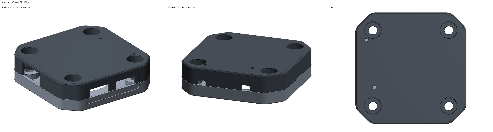
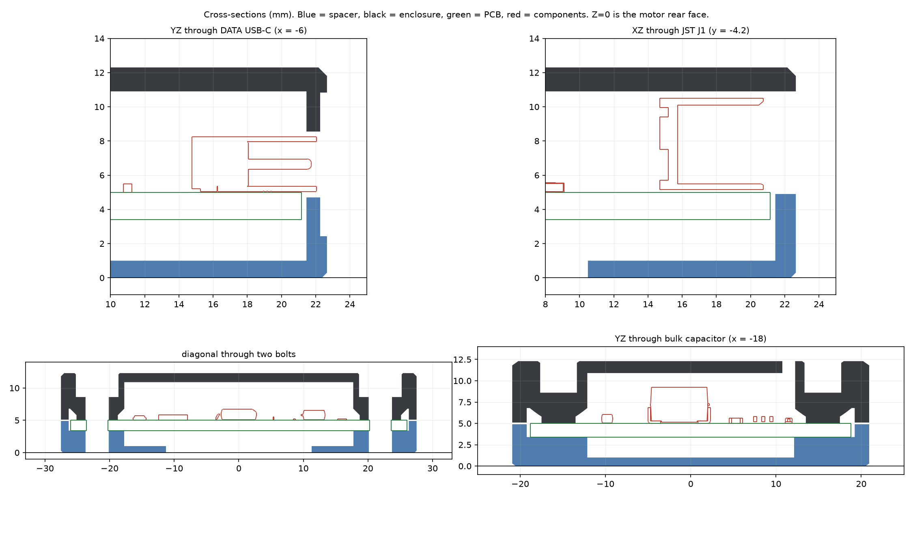

# NEMA17 flat-top enclosure — r2 fit-test draft

A spacer tray and a cover for the
[RP2040 motor-controller PCB](https://tscircuit.com/imrishabh18/rp2040-motor-controller)
v1.0.58. The top is one flat face, so the motor can stand upright on it and a
label can go on it. Nothing has been printed or test-fitted yet.



| Part | Z range | Features |
| --- | --- | --- |
| Spacer tray (`spacer`, r1) | 0 to 4.9 mm | 1 mm insulating floor, Ø22.6 mm center opening, four bolt sleeves that seat the PCB at 3.4 mm, and a wall around the PCB edge |
| Cover (`cover`, r2) | 5.0 to 12.3 mm | Flat top, four recessed M3 pockets, a hole above and a side-wall notch beside each LED, USB-C and JST openings in the side walls |

The assembled envelope is 45.3 × 45.32 × 12.3 mm on a 31 × 31 mm bolt pattern.
Z = 0 is the motor's rear face. The USB-C ports face +Y and the JST motor
connector faces +X. STEP and STL downloads are in
`dist/assets/nema17-flat-top-enclosure/` and on the
[Assets page](../../dist/assets.html#nema17-flat-top-enclosure-heading). Both
keep their assembly coordinates, so turn the cover over in the slicer and print
it with the top face on the bed.

## How it differs from the v4 enclosure

The [v4 enclosure](../nema17-enclosure/) is 42 × 42 mm and leaves the PCB edge
visible at the seam. This one walls in the PCB's back face and edges, so it is
1.5 mm wider than the PCB on every side (0.3 mm gap plus a 1.2 mm wall) and
overhangs a 42.3 mm motor body by the same amount.

The parts meet at the PCB's top surface with a 0.2 mm seam. The split is there
because the USB-C shells overhang the board edge by 0.89 mm, so a cover with a
full-height skirt could not be lowered over them.

The bolt stack matches v4: the PCB underside is 3.4 mm above the motor and the
M3 head seat is 8.6 mm above it, so bolts chosen for v4 carry over. The head
pockets are 3.7 mm deep, which puts a 3 mm M3 cap head 0.7 mm below the top
face.

## Openings

- **USB-C:** one opening fitted to each receptacle shell, inside a shared
  13.3 × 8.4 mm-per-port recess for plug overmolds. The receptacle mouths sit
  0.21 mm behind the recess floor.
- **JST PH:** a window in the +X wall from the PCB surface to the ceiling.
- **LED top holes:** a straight Ø1.5 mm hole through the 1.4 mm roof above
  `D_PWR` (green power LED, x −18.0, y 11.5) and `D_STATUS` (RGB status LED,
  x −14.9, y −7.9). The LEDs sit 5.3 to 5.5 mm below the roof, so each one is
  seen directly only from within a few degrees of straight above; from other
  angles the hole shows the lit interior.
- **LED side notches (r2):** a 4 mm wide notch in the −X wall beside each LED,
  open at the cover's bottom edge and reaching 2.4 mm above the PCB surface,
  with R1 top corners. `D_PWR` is 3.45 mm from the inner wall and `D_STATUS`
  is 6.55 mm from it. The parts between each LED and its notch are low:
  0.5 mm passives, plus a 1.05 mm transistor (`Q_PD_ENABLE`) along one edge of
  the status LED's notch. The notches need no support when the cover is
  printed top face down.

The BOOT and RUN buttons are not reachable with the cover on, and there are no
vents. `VENTS = True` in `build-cad.py` adds v4-style slots to the −X and −Y
walls; the −X slots would need moving to clear the LED notches.

## Label

A 38.1 × 19.05 mm label (the v4 sticker) fits between the four screw pockets.
Centered with its long side along X, as on v4, it covers the status LED's top
hole; the power LED's top hole stays clear. Turned 90° it clears both holes.
The side notches are unaffected either way.

## Things to check on the first print

- The J1 3D model in the published board sits 2.5 mm outboard of its own
  solder pads. The JST window is sized from the pads (`J1_MODEL_DX`), which put
  the connector face 0.41 mm inside the board edge. The window runs through
  the whole wall, so either position fits.
- The wall between the power LED hole and the nearest screw pocket is 0.67 mm
  thick, thinning to 0.47 mm at the pocket's entry chamfer.
- The motor's rear geometry, bolt length and thread engagement are unverified.
- USB-C cable overmolds larger than 12.7 × 7.8 mm will not seat.

## Rebuild CAD

Use an isolated Python 3.11/3.12 environment:

```sh
python3 -m venv .venv-enclosure
.venv-enclosure/bin/pip install -r mechanical/nema17-flat-top-enclosure/requirements.txt
.venv-enclosure/bin/python mechanical/nema17-flat-top-enclosure/build-cad.py
```

The builder writes STEP and STL to its ignored `models/` folder and
`reports/design-report.json`. It fails if either part overlaps the PCB or
comes within 0.25 mm of a component envelope, if a bolt bore, head pocket or
LED sight line is obstructed, or if the top is not a single flat face. To
publish a new revision, bump the changed part in `REVISIONS`, copy its STEP
and STL from `models/` to `dist/assets/nema17-flat-top-enclosure/`, and update
the names, hashes and dimensions in `src/enclosure-catalog.tsx`. STEP files
carry a timestamp, so do not re-copy a part whose geometry has not changed.

`component-envelopes-v1.0.58.json` holds one bounding box per placed
component. To regenerate it for a new board revision, download the release's
`dist/index/circuit.json` as `board.circuit.json`, then:

```sh
tsci export board.circuit.json -f glb
.venv-enclosure/bin/python mechanical/nema17-flat-top-enclosure/extract-envelopes.py board.glb \
  > mechanical/nema17-flat-top-enclosure/component-envelopes-v1.0.58.json
```


