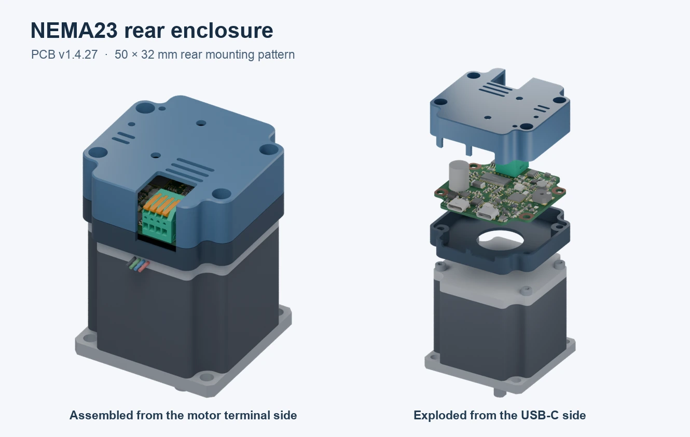

# NEMA23 rear controller enclosure · R2

This two-piece enclosure is for the scalloped, 56 × 56 × 1.6 mm PCB marked
**REV N / PROTOTYPE · v1.4.27**. The four-pole motor connector is a KEFA
KF208RA-2.54-4P spring clamp. Its wires enter from the motor's lead-exit side.
The two USB-C receptacles face the opposite edge.
[PCB design](https://tscircuit.com/imrishabh18/nema-23-stepper-controller?version=1.4.27#pcb) ·
[Terminal family](https://www.kefaelectronic.com/KF208RA-2-5-2-54-Spring-type-terminal-block-pd541140758.html)



## Print

The **R2 3MF print plate** contains the R2 cover and R1 tray already oriented and spaced.
Individual STEP and STL files retain their assembly coordinates. For separate
STLs, print the tray motor-face down and flip the cover flat outer face down.
The assembled case is **60.2 × 60.2 × 26.9 mm** above the rear face.
[Print plate, STL and STEP files](../../dist/assets/nema23-enclosure/)

Bambu Studio sliced the 3MF on an X1 Carbon profile with a 0.4 mm nozzle,
0.20 mm layers and supports disabled. The PETG HF estimate for the pair was
about 40 minutes and 22 g.

## Mount to the motor

1. Measure the four rear screw centers. Viewed from the PCB side with the USB
   ports at the top, the horizontal pitch is **50 mm** and the vertical pitch is
   **32 mm**. The reference motor uses M3 rear screws. The tray has four
   Ø6.6 × 3.5 mm underside pockets so it can sit over the original screw heads
   for a dry fit. The Ø24 mm center opening clears the middle of the rear cap.
   [Reference motor geometry](https://github.com/tscircuit/modelprinter/blob/v0.0.36/tests/nema23-rear-profile.test.ts)
2. Seat the PCB on the four tray bosses with the terminal facing the motor
   leads and the USB-C ports in the two tray notches. The PCB underside is
   8 mm above the motor. Check for proud solder tails or a projecting rear shaft.
3. Lower the cover over the PCB. Its four feet bear around the board holes.
   For final attachment, four replacement screws pass through cover, PCB and
   tray into the motor's rear fasteners. The Ø3.7 mm shank bores and Ø6.8 mm
   head pockets accept the modeled Ø5.5 mm M3 socket heads. The new head
   bearing plane is 15 mm above the rear face. If the original heads seat
   flush with that face, an under-head length 15 mm longer preserves the
   original engagement. Check the actual thread, seating depth and available
   engagement on the motor before choosing screws.
4. Insert the motor leads through the open end of the terminal bay. All four
   orange push tabs are accessible from above. The USB-C openings are sized
   for plug bodies up to the checked 12.7 × 7.8 mm envelope. Roof holes give
   access to BOOT and RUN and a view of the two LEDs. The roof is 1.8 mm
   thick over the driver and buzzer.

## Fit checks

The CAD checks cover the PCB, the four screw paths, 135 populated component
envelopes, the plug and clamp access paths, and 3.5 mm of solder-tail space
below each through-hole pin. The closest nominal component clearance is
0.70 mm at the terminal. The 12.5 mm bulk capacitor has 3.0 mm of overhead.
The checks use a conservative envelope for the L_AVDD ferrite, which lacks a
published mesh. The STEP solids and STL meshes each form one closed body per
part. Physical fit, any added heatsink, and temperatures under load still
need a hardware check.

## Rebuild

Run from this directory with Python 3.11 or 3.12.

```sh
python3 -m venv .venv
.venv/bin/pip install -r requirements.txt
.venv/bin/python build-cad.py
```

The builder checks the solids and writes the exports to `models/`.
The 3MF contains the same two STL meshes. To regenerate `board-v1.4.27.json`,
download the exact release circuit and export it with tsci 0.0.3288.
The mechanical input records the circuit SHA-256 and all coordinates use mm.

```sh
curl -fsSL 'https://api.tscircuit.com/package_files/get?package_file_id=7c740044-85e4-4a6c-958f-283ff21bd227' | jq -jr '.package_file.content_text' > board.circuit.json
tsci export board.circuit.json -f glb -o board.glb
python3 extract-board.py board.circuit.json board.glb > board-v1.4.27.json
```
